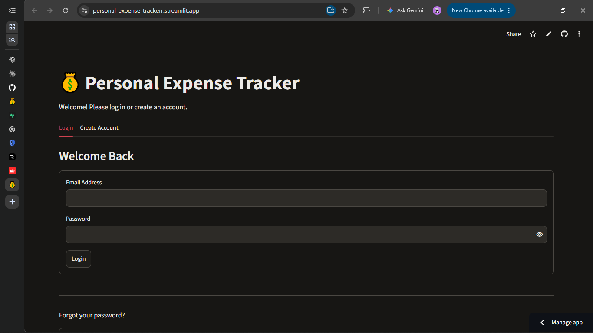
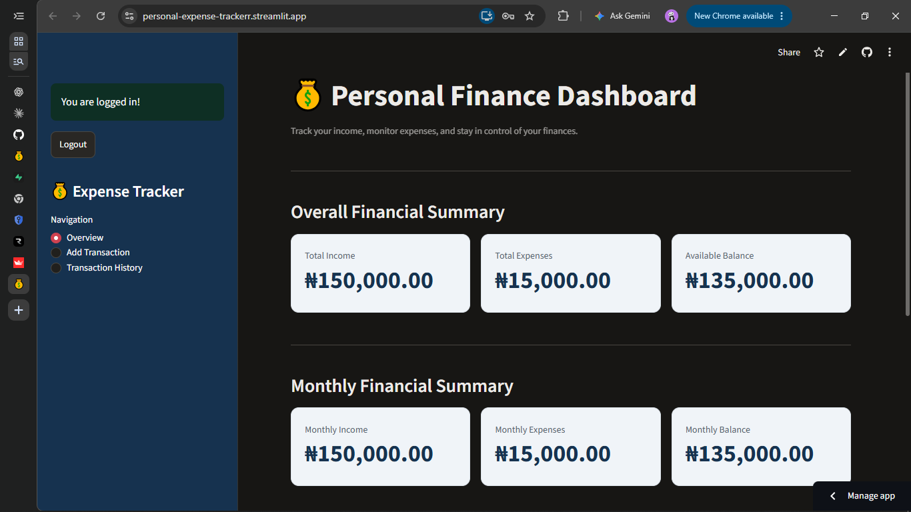
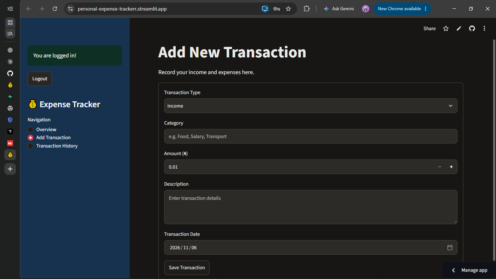
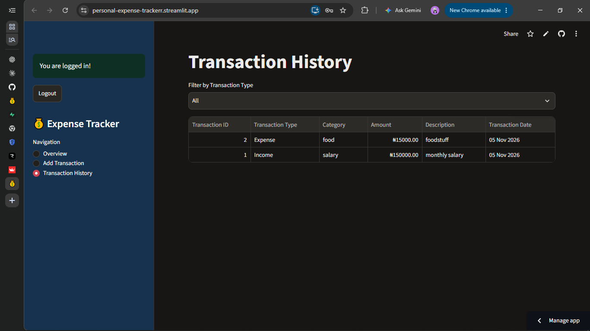

# Personal Expense Tracker 💰

A Python-based expense tracking application that helps users manage their income, monitor expenses, and keep track of their financial activities.

The project includes a command-line version built with SQLite and a web-based version built with Streamlit and Supabase.

## Features

- User registration and email/password login
- Secure user authentication
- Add income and expense transactions
- Categorize financial transactions
- View transaction history
- Filter transactions by type
- View total income, expenses, and available balance
- Monthly financial summaries
- Visual financial analytics and charts
- User-specific transaction records

## Technologies Used

- Python
- Streamlit
- SQLite
- Supabase (PostgreSQL)
- Matplotlib
- Git and GitHub

## Live Application

[Open Personal Expense Tracker](https://personal-expense-trackerr.streamlit.app/)

## Project Structure

```text
personal-expense-tracker/
│
├── app.py
├── auth.py
├── database.py
├── supabase_client.py
├── requirements.txt
├── .gitignore
└── README.md
```

## Installation and Setup

### 1. Clone the repository

```bash
git clone https://github.com/beo-01/personal-expense-tracker.git
```

### 2. Navigate into the project folder

```bash
cd personal-expense-tracker
```

### 3. Create a virtual environment

```bash
python -m venv .expense_env
```

### 4. Activate the virtual environment

Windows PowerShell:

```powershell
.\.expense_env\Scripts\Activate.ps1
```

### 5. Install dependencies

```bash
pip install -r requirements.txt
```

### 6. Configure Supabase

Create a `.streamlit/secrets.toml` file and add your Supabase project credentials:

```toml
SUPABASE_URL = "your-supabase-project-url"
SUPABASE_KEY = "your-supabase-publishable-key"
```

Never upload your credentials or secrets to GitHub.

### 7. Run the application

```bash
streamlit run app.py
```


## Application Screenshots

### Login Page


### Financial Dashboard


### Add Transaction


### Transaction History



## Database

The web application uses Supabase PostgreSQL to store transaction records.

Row Level Security (RLS) policies ensure that authenticated users can access only their own transactions.

The command-line version uses SQLite for local data storage.

## Future Improvements

- Improved password recovery experience
- Monthly and yearly financial reports
- Budget management
- Export transactions to CSV
- Improved dashboard design

## Author

**Bolaji Olatunji**

GitHub: [@beo-01](https://github.com/beo-01)
